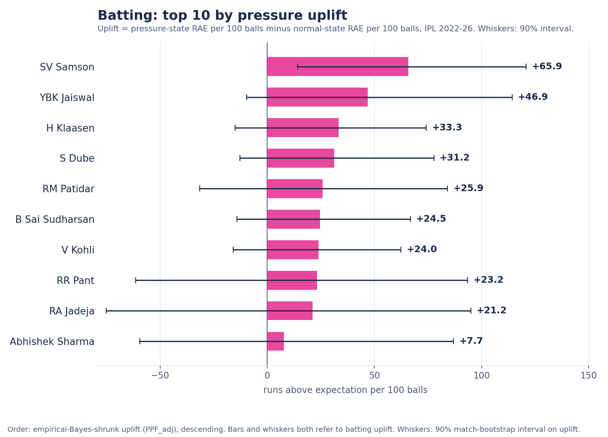
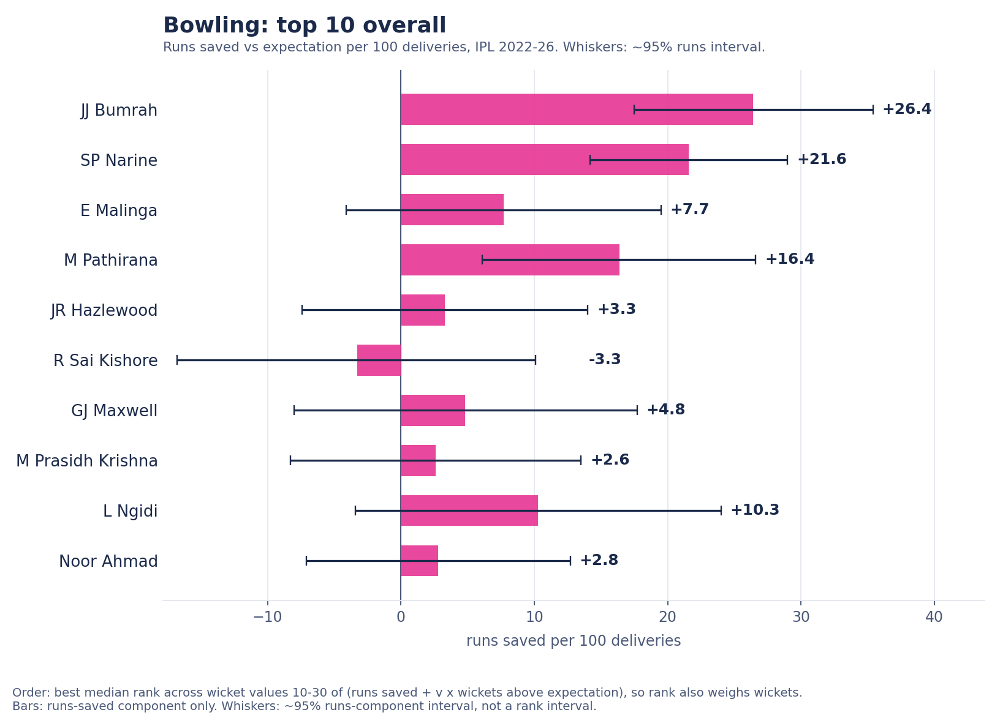
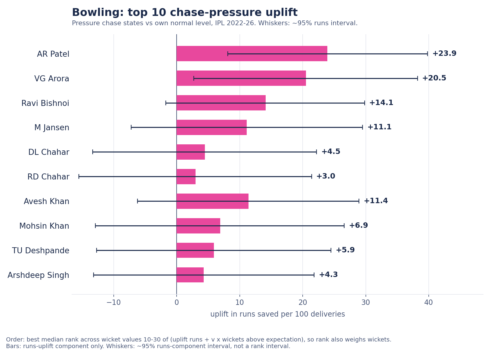

# Royals Auction Arena

A pressure-aware player analysis platform for IPL auction scouting. Royals Auction Arena measures every batter and bowler against what a model expects from the match situation, then shows who delivers above that level overall, in high-pressure moments, and when the stakes rise. It covers IPL seasons 2022-26 with ball-by-ball data and ships as three connected parts: a bowling pipeline, a batting pipeline and an interactive analysis website.

**Live site:** https://royals-auction-arena.vercel.app/

## Highlights

- **Situation-aware player scoring.** Each delivery is judged against model expectation for its match state, so players are compared on what they did relative to the situation they faced.
- **Pressure and uplift as separate lenses.** See who performs under pressure and who raises their game compared with their own normal level, in both batting and bowling.
- **Innings-aware bowling lists.** Overall, chase pressure, chase uplift, first-innings pressure and first-innings uplift each get their own ranking.
- **Interactive website.** Batting and bowling views, role/style, team and sample filters, side-by-side player comparison, responsive charts with interval labels, and CSV export of the current view.
- **Pitch assistant.** Ask questions about rankings and the factors behind them in plain language, answered from the site's methodology and player summaries.
- **Reproducible pipelines.** Public Cricsheet data in, scripted steps, fixed seeds and configs, frozen trained models for bowling, and test suites for both packages.
- **Leakage-controlled modelling.** Features use only pre-ball information and strictly earlier dates, and out-of-sample scoring follows season order.
- **Lightweight deployment.** The site is static HTML, CSS and JavaScript with SVG charts, no database and no npm dependencies.

The analysis is a description of past performance, built to inform scouting and auction discussion.

## Contents

- [Highlights](#highlights)
- [What it measures](#what-it-measures)
- [Results at a glance](#results-at-a-glance)
- [Repository layout](#repository-layout)
- [Architecture](#architecture)
- [Quick start](#quick-start)
- [Methodology summary](#methodology-summary)
- [Key formulas](#key-formulas)
- [Validation](#validation)
- [Pitch assistant](#pitch-assistant)
- [Data and attribution](#data-and-attribution)

## What it measures

Every list answers one question, and each lens is reported separately by design, so every ranking stays interpretable on its own terms.

| Lens | Question | Scope |
| --- | --- | --- |
| Overall | How does the player compare with model expectation across all deliveries? | Both disciplines |
| Under pressure | How does the player perform in high-pressure match states? | Batting; bowling per innings |
| Uplift | How does pressure-state performance differ from the player's own normal-state performance? | Batting; bowling per innings |

Bowling is reported per innings: overall, chase pressure, chase uplift, first-innings pressure and first-innings uplift. Innings-specific lists are not combined. Batting uses legal balls faced and bowling uses delivery attempts, so each discipline is read on its own scale.

## Results at a glance

Top-10 views from the current 2022-26 analysis, matching the live site. Whiskers show the published interval for each chart: 90% for batting uplift, about 95% for the bowling runs component.





The bowling overall order is the composite rank across wicket values 10-30, so it also weighs wickets above expectation; the bars show the runs-saved component. Each chart carries its own ordering note, so it stays self-explanatory when shared on its own.



Chase uplift is ordered the same composite way; the bars show the runs-uplift component.

The full lists, with filters, side-by-side comparison and CSV export, are on the [live site](https://royals-auction-arena.vercel.app/).

## Repository layout

```
.
├── bowling-analysis/   Python pipeline, models, tests, frozen estimators
├── batting-analysis/   Python pipeline, config, methodology, tests
└── dashboard/          Static website, importer, exporter, serverless assistant
```

| Path | Contents |
| --- | --- |
| [`bowling-analysis/`](bowling-analysis/) | Ball-by-ball loading and features, boundary-risk (BoPI) model, expected runs and wickets, pressure scoring (v5), selection funnel, validation, 61 tests (count from its README). Frozen estimators in `outputs/frozen_models.joblib`. See [its README](bowling-analysis/README.md). |
| [`batting-analysis/`](batting-analysis/) | Pre-ball pressure index (BPI) via nested out-of-fold stacking, expected runs and dismissal, pressure performance factor (PPF) with empirical-Bayes shrinkage, selection funnel, 18 tests (count from its README). See [its README](batting-analysis/README.md) and [METHODOLOGY.md](batting-analysis/METHODOLOGY.md). |
| [`dashboard/`](dashboard/) | Hash-routed static site (HTML, CSS, JavaScript, SVG charts, JSON data), data importer, static exporter, integrity checks, Vercel serverless assistant. See [its README](dashboard/README.md) and [`dashboard/docs/`](dashboard/docs/). |

## Architecture

```
Cricsheet IPL JSON
        |
        v
 bowling-analysis/         batting-analysis/
 (Python, pandas,          (Python, scikit-learn,
  scikit-learn, XGBoost)    LightGBM, statsmodels)
        |                        |
        +---- aggregate exports --+
                     |
                     v
        dashboard/scripts/import_data.py
        (schema v1, SHA-256 provenance)
                     |
          +----------+-----------+
          |                      |
          v                      v
 export-static.mjs -> dist/   dashboard/web as Vercel root
 (static hosting only,        (static files + api/assistant.js
  no assistant)                + lib/ -> Pitch assistant)
```

- The analysis packages are independent of each other and of the website.
- The website never fits models. It reads verified aggregate exports and does sorting, filtering, comparison and CSV export in the browser. Missing values stay null; nothing is interpolated or imputed.
- Only summary aggregates are exported. The public build excludes raw inputs, Python sources, models and logs.
- The hosted site sends a restrictive Content Security Policy and `nosniff`. Untrusted text is HTML-escaped and CSV output is guarded against spreadsheet-formula injection.

Details: [ARCHITECTURE.md](dashboard/docs/ARCHITECTURE.md), [DATA_CONTRACT.md](dashboard/docs/DATA_CONTRACT.md), [METRICS.md](dashboard/docs/METRICS.md), [VERIFICATION.md](dashboard/docs/VERIFICATION.md), [RELEASE.md](dashboard/docs/RELEASE.md).

## Quick start

### Bowling analysis

Python 3.10-3.13.

```sh
cd bowling-analysis
python3 -m venv .venv && source .venv/bin/activate   # Windows: py -m venv .venv
pip install -r requirements.txt
python download_data.py      # fetches the public Cricsheet IPL archive
python run.py                # rebuilds scores, lists, validation outputs, plots
python -m pytest tests/ -q
```

Some tests read generated outputs, so run the pipeline before the test suite. Exact package versions of the documented run are in `environment.txt`; the archive checksum is in `SOURCES.json`. A fresh download can shift results. `outputs/frozen_models.joblib` is a trusted local artifact; do not load joblib or pickle files from untrusted sources.

### Batting analysis

```sh
cd batting-analysis
python3 -m pip install -r requirements.txt
mkdir -p outputs logs
export IPL_JSON_DIR=/path/to/ipl_json    # or unpack to data/raw/ipl_json
python3 data_loader.py && python3 features.py && python3 mpi_lpi_models.py \
  && python3 stacker.py && python3 relation_analysis.py && python3 expected_runs.py \
  && python3 ppf.py && python3 selector.py && python3 validate.py
python3 -m pytest tests/ -q
```

Run the scripts in this order; each step reads the previous step's outputs. Dependencies are minimum supported versions, not a lockfile.

### Website

Requires Node.js 20+. There are no npm dependencies and no database.

```sh
cd dashboard
python3 scripts/import_data.py \
  --batting /path/to/batting/outputs \
  --bowling /path/to/bowling/outputs/bowler_model_data_v5.json
npm start                    # http://127.0.0.1:3000
npm test
python3 -m unittest discover -s tests -p 'test_import.py'
```

The importer needs `batsman_ppf.csv`, `shortlist_35.csv`, `top10_batsmen.csv` and `top10_role_quota.csv` from the batting run, and the v5 bowling JSON. Without an imported dataset the site shows an import screen rather than sample data.

`npm start` runs a local static server (`server.mjs`) for the site and dataset. Pitch runs on the Vercel deployment (see [Deployment](#deployment)), so the local server is static-only by design.

### Deployment

There are two deployment shapes. Pick by whether you want Pitch.

**Static site without Pitch.** From `dashboard/`:

```sh
npm run build                # reads private/dataset.json, writes dist/
```

`dist/` contains the HTML, CSS, JavaScript, fonts, images, `dataset.json`, attribution and a `vercel.json` with the security headers, ready to deploy as the static project root with no install or build command. For Pitch, use the Vercel shape below, which adds `api/` and `lib/`.

**Site with Pitch (Vercel).** The serverless function and its bundled data live under `dashboard/web/`, whose `vercel.json` declares `api/assistant.js` and bundles `lib/**` into it. Use `dashboard/web` as the Vercel project root directory:

```sh
cd dashboard
cp /path/to/dataset.json web/dataset.json                 # gitignored
node scripts/generate-assistant-data.mjs web/dataset.json # writes web/lib/players.json (gitignored)
```

Run the generator after the dataset exists and before each deploy, with `dashboard/` as the working directory. Then set `GEMINI_API_KEY` in the Vercel project (see [Pitch assistant](#pitch-assistant)) and deploy `dashboard/web`.

Inspect `dataset.json` before deploying: it contains player-level aggregates and source-file hashes only. The static assets and player-level aggregates in the deployed root are public. `GEMINI_API_KEY` stays server-side in the Vercel project settings and is never part of the served files.

## Methodology summary

### Bowling (v5)

- **Pressure signal.** A chase win score from exact dynamic programming over runs needed, legal balls left and wickets lost; a first-innings score from a monotone gradient-boosted classifier on runs, balls and wickets. v5 adds per-fold isotonic calibration.
- **States.** Pressure is a calibrated score in [0.6, 0.9). Normal is below 0.6. Near-decided states (calibrated score >= 0.95 or <= 0.05) are excluded from both pools in both innings.
- **Expectation.** Boundary-risk (BoPI), expected runs and expected wickets are estimated per delivery from match state, venue, batter context and phase. No bowler identity enters the expectation.
- **Scoring.** Runs saved against expectation plus a weighted wicket term, reported with wicket values of 10, 20 and 30 side by side. Runs and wickets components are shrunk separately toward the population mean (DerSimonian-Laird).
- **Uplift.** A within-phase regression of the delivery residual on a pressure indicator, with match-clustered standard errors.
- **Chronology.** Season Y scores are out-of-sample, trained on earlier seasons only. The 2025-26 models are fitted on 2022-24.

### Batting

- **Pressure index (BPI).** 100 x P(dot ball or dismissal) from pre-ball features, via nested grouped cross-validation with a stacked estimator. No ball is scored by a model that saw its match.
- **Expectation.** Situation-only expected runs and dismissal. The wicket penalty is the expected runs the incoming batter adds from that state.
- **PPF.** Pressure RAE per 100 balls minus normal RAE per 100 balls, with recency weights (1.0 for 2025-26, 0.6 for 2022-24), empirical-Bayes shrinkage, and 1000-resample match-bootstrap 90% intervals.
- **Selection funnel.** At least 60 pressure balls and 200 normal balls, active in 2025 or 2026, shortlist of 35, analysis top 10, and a role-balanced 3 openers / 4 middle order / 3 finishers variant.

## Key formulas

**Batting.** The pressure index is the modeled chance that the current legal ball is a dot or a striker dismissal, built from pre-ball information only:

$$\mathrm{BPI} = 100 \times P(\text{dot ball or striker dismissal} \mid \text{pre-ball state})$$

Runs above expectation per ball, where $\pi(\text{over}, \text{wickets})$ is the expected runs the incoming batter adds from that state:

$$\mathrm{RAE} = \big(r - \mathrm{E}[r \mid \text{state}]\big) - \pi(\text{over}, \text{wickets}) \times \big(d - \mathrm{E}[d \mid \text{state}]\big)$$

The pressure performance factor and its empirical-Bayes-shrunk uplift, with shrinkage weight $\lambda_i$:

$$\mathrm{PPF} = \mathrm{RAE}_{100}^{\mathrm{pressure}} - \mathrm{RAE}_{100}^{\mathrm{normal}}, \qquad \mathrm{uplift}_i = \lambda_i \times \mathrm{PPF}_i, \qquad \lambda_i = \frac{\sigma^2_{\mathrm{between}}}{\sigma^2_{\mathrm{between}} + \sigma^2_{\mathrm{within},\,i}}$$

**Bowling.** Runs above expectation per delivery, reported side by side at wicket values $v$ of 10, 20 and 30:

$$\mathrm{RAE}_{\mathrm{bowl}} = \mathrm{E}[R \mid \text{state}] - \text{runs conceded} + v \times \text{wicket}$$

Pressure states come from the calibrated score $s$: pressure is $0.6 \le s < 0.9$, normal is $s < 0.6$, and near-decided states ($s \ge 0.95$ or $s \le 0.05$) sit outside both pools. Uplift is the within-phase pressure-minus-normal regression coefficient with match-clustered standard errors.

## Validation

- Alternate-match and early/late split checks, with the cohort stated for each.
- Temporal holdout: all fitting restricted to 2022-24, with 2025-26 scored frozen.
- Leakage tests: shift tests on features, expanding-window history over strictly earlier dates, and same-day matches never informing each other.
- Match-clustered bootstrap intervals, a placebo with pressure labels shuffled within bowler and phase, forward-association checks and a v5 tail audit.
- Website: unit tests for selection and ordering, server tests, importer tests, a dataset integrity script and optional Playwright browser checks (including 390px and 320px viewports).

Bowler overall runs-saved level repeats well enough to rank on (Spearman 0.31 alternate-match, 0.43 early/late). Pressure and uplift lists are presented with their intervals for exploration. Test counts above are taken from the package READMEs; data-dependent tests need the pipeline outputs first. Full results are in each package's README and in [`batting-analysis/METHODOLOGY.md`](batting-analysis/METHODOLOGY.md).

## Pitch assistant

Pitch is the on-site Q&A assistant (`dashboard/web/assistant.js`, with a Vercel serverless function in `dashboard/web/api/assistant.js`). It answers questions about the rankings and their factors from the site's methodology text and player summary rows, with off-topic and prompt-injection guards.

Environment variables, set in the hosting project and never committed:

| Variable | Required | Purpose |
| --- | --- | --- |
| `GEMINI_API_KEY` | Yes | Gemini API key |
| `ASSISTANT_MODELS` | No | Comma-separated fallback model list |
| `ASSISTANT_DAILY_CAP` | No | Soft daily answer cap, default 400. Counted per warm serverless instance, so it is not a global or hard limit. A per-client limit of 8 requests/minute applies on the same basis |

`web/lib/knowledge.json` (methodology text) is committed. `web/lib/players.json` and `web/dataset.json` are generated and gitignored. Regenerate the assistant data before each deploy, from `dashboard/` (see [Deployment](#deployment)):

```sh
node scripts/generate-assistant-data.mjs web/dataset.json
```

Without `players.json` the site is unaffected and Pitch answers methodology questions only.

## Data and attribution

- Ball-by-ball data: [Cricsheet](https://cricsheet.org/downloads/) IPL JSON, under the [Open Data Commons Attribution License](https://opendatacommons.org/licenses/by/1-0/) (license copy in `bowling-analysis/data/Cricsheet_LICENSE.txt`).
- Bowling pace/spin reporting tags: [aadi-jn/indian-premier-league](https://github.com/aadi-jn/indian-premier-league/blob/main/docs/data_dictionary.md), joined by registry ID and used for reporting views only.
- Source counts for 2022-26 are 74/74/71/74/74 matches (367); 355 are used after 12 exclusions for revised targets, reduced overs, no results or missing innings. Super overs are excluded.
- Raw match data, trained parquet files and generated datasets are not stored in the repository. Team labels are historical records, not current contracts or auction eligibility. See [`dashboard/DATA_ATTRIBUTION.txt`](dashboard/DATA_ATTRIBUTION.txt).
