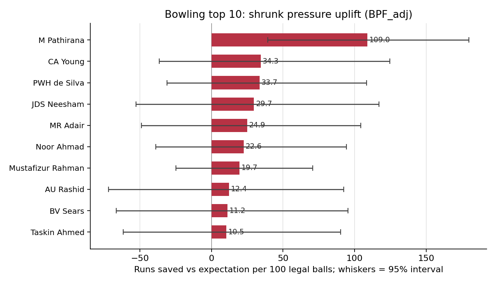

# Royals Auction Arena

A pressure-aware player analysis platform for IPL auction scouting. Royals Auction Arena measures every batter and bowler against what a model expects from the match situation, then shows who delivers above that level overall, in high-pressure moments, and when the stakes rise. It covers 867 ball-by-ball fixtures from the supplied CSV data (IPL, T20I and Asia Cup tournaments, 2022-26) and ships as three connected parts: a bowling pipeline, a batting pipeline and an interactive analysis website.

**Live site:** https://royals-auction-arena.vercel.app/

## Highlights

- **Situation-aware player scoring.** Each delivery is judged against model expectation for its match state, so players are compared on what they did relative to the situation they faced.
- **Pressure and uplift as separate lenses.** See who performs under pressure and who raises their game compared with their own normal level, in both batting and bowling.
- **A funnel-based final list plus innings-aware views.** The published bowling top 10 comes from an eligibility and shortlist funnel ordered by shrunk pressure-minus-normal uplift; overall, chase and first-innings views sit alongside it.
- **Interactive website.** Batting and bowling views, role/style, team and sample filters, side-by-side player comparison, responsive charts with interval labels, and CSV export of the current view.
- **Pitch assistant.** Ask questions about rankings and the factors behind them in plain language, answered from the site's methodology and player summaries.
- **Reproducible pipelines.** Supplied ball-by-ball CSV data in, scripted steps, fixed seeds and configs, frozen trained models for bowling, and test suites for both packages.
- **Leakage-controlled modelling.** Features use only pre-ball information and strictly earlier dates, and out-of-sample scoring follows season order.
- **Lightweight deployment.** The site is static HTML, CSS and JavaScript with SVG charts, no database and no npm dependencies.

The analysis is a description of past performance, built to inform scouting and auction discussion.

## Contents

- [Highlights](#highlights)
- [What it measures](#what-it-measures)
- [Results at a glance](#results-at-a-glance)
- [Repository layout](#repository-layout)
- [Architecture](#architecture)
- [Quick start](#quick-start)
- [Methodology summary](#methodology-summary)
- [Key formulas](#key-formulas)
- [Validation](#validation)
- [Pitch assistant](#pitch-assistant)
- [Data and attribution](#data-and-attribution)

## What it measures

Every list answers one question, and each lens is reported separately by design, so every ranking stays interpretable on its own terms.

| Lens | Question | Scope |
| --- | --- | --- |
| Overall | How does the player compare with model expectation across all deliveries? | Both disciplines |
| Under pressure | How does the player perform in high-pressure match states? | Batting; bowling per innings |
| Uplift | How does pressure-state performance differ from the player's own normal-state performance? | Batting; bowling per innings |

The published bowling list pools both innings through the selection funnel: eligibility floors, an overall-skill shortlist, then ordering by shrunk pressure-minus-normal uplift (BPF_adj). Overall, chase and first-innings views sit alongside it as supplementary lenses on the same delivery scores. Batting uses legal balls faced and bowling uses legal balls bowled, so each discipline is read on its own scale.

## Results at a glance

Top-10 views from the current 2022-26 analysis of the supplied matches, matching the live site. Whiskers show the published interval for each chart: 90% for batting uplift, 95% match-bootstrap for bowling uplift.

Batting final list (shrunk pressure-minus-normal uplift, PPF_adj):

| # | Batter | Uplift /100 |
| --- | --- | --- |
| 1 | TH David | 72.5 |
| 2 | C Green | 53.4 |
| 3 | V Suryavanshi | 36.4 |
| 4 | Abhishek Sharma | 34.1 |
| 5 | V Kohli | 24.4 |
| 6 | RR Hendricks | 24.3 |
| 7 | RM Patidar | 23.7 |
| 8 | AD Russell | 23.0 |
| 9 | MR Marsh | 21.3 |
| 10 | GD Phillips | 20.5 |


Bowling final list (funnel order by shrunk uplift, BPF_adj):

| # | Bowler | Uplift /100 |
| --- | --- | --- |
| 1 | M Pathirana | 109.0 |
| 2 | CA Young | 34.3 |
| 3 | PWH de Silva | 33.7 |
| 4 | JDS Neesham | 29.7 |
| 5 | MR Adair | 24.9 |
| 6 | Noor Ahmad | 22.6 |
| 7 | Mustafizur Rahman | 19.7 |
| 8 | AU Rashid | 12.4 |
| 9 | BV Sears | 11.2 |
| 10 | Taskin Ahmed | 10.5 |



The chase-innings uplift view offers a second, innings-specific lens on the same delivery scores.


Exact placings depend on the method's pressure cutoffs, sample floors and selection rules, so fine rank differences are approximate. The full lists, with filters, side-by-side comparison and CSV export, are on the [live site](https://royals-auction-arena.vercel.app/).

## Repository layout

```
.
├── bowling-analysis/   Python pipeline, models, tests, frozen estimators
├── batting-analysis/   Python pipeline, config, methodology, tests
└── dashboard/          Static website, importer, exporter, serverless assistant
```

| Path | Contents |
| --- | --- |
| [`bowling-analysis/`](bowling-analysis/) | Ball-by-ball loading and features, boundary-risk (BoPI) model, expected runs and wickets, pressure scoring (BoPI/BPF), selection funnel, validation, 61 tests (count from its README). Frozen estimators in `outputs/frozen_models.joblib`. See [its README](bowling-analysis/README.md). |
| [`batting-analysis/`](batting-analysis/) | Pre-ball pressure index (BPI) via nested out-of-fold stacking, expected runs and dismissal, pressure performance factor (PPF) with empirical-Bayes shrinkage, selection funnel, 18 tests (count from its README). See [its README](batting-analysis/README.md) and [METHODOLOGY.md](batting-analysis/METHODOLOGY.md). |
| [`dashboard/`](dashboard/) | Hash-routed static site (HTML, CSS, JavaScript, SVG charts, JSON data), data importer, static exporter, integrity checks, Vercel serverless assistant. See [its README](dashboard/README.md) and [`dashboard/docs/`](dashboard/docs/). |

## Architecture

```
Cricsheet IPL JSON
        |
        v
 bowling-analysis/         batting-analysis/
 (Python, pandas,          (Python, scikit-learn,
  scikit-learn, XGBoost)    LightGBM, statsmodels)
        |                        |
        +---- aggregate exports --+
                     |
                     v
        dashboard/scripts/build_dataset.py
        (schema v1, SHA-256 provenance)
                     |
          +----------+-----------+
          |                      |
          v                      v
 export-static.mjs -> dist/   dashboard/web as Vercel root
 (static hosting only,        (static files + api/assistant.js
  no assistant)                + lib/ -> Pitch assistant)
```

- The analysis packages are independent of each other and of the website.
- The website never fits models. It reads verified aggregate exports and does sorting, filtering, comparison and CSV export in the browser. Missing values stay null; nothing is interpolated or imputed.
- Only summary aggregates are exported. The public build excludes raw inputs, Python sources, models and logs.
- The hosted site sends a restrictive Content Security Policy and `nosniff`. Untrusted text is HTML-escaped and CSV output is guarded against spreadsheet-formula injection.

Details: [ARCHITECTURE.md](dashboard/docs/ARCHITECTURE.md), [DATA_CONTRACT.md](dashboard/docs/DATA_CONTRACT.md), [METRICS.md](dashboard/docs/METRICS.md), [VERIFICATION.md](dashboard/docs/VERIFICATION.md), [RELEASE.md](dashboard/docs/RELEASE.md).

## Quick start

### Bowling analysis

Python 3.10-3.13.

```sh
cd bowling-analysis
python3 -m venv .venv && source .venv/bin/activate   # Windows: py -m venv .venv
pip install -r requirements.txt
python download_data.py      # fetches the public Cricsheet IPL archive
python run.py                # rebuilds scores, lists, validation outputs, plots
python -m pytest tests/ -q
```

Some tests read generated outputs, so run the pipeline before the test suite. Exact package versions of the documented run are in `environment.txt`; the archive checksum is in `SOURCES.json`. A fresh download can shift results. `outputs/frozen_models.joblib` is a trusted local artifact; do not load joblib or pickle files from untrusted sources.

### Batting analysis

```sh
cd batting-analysis
python3 -m pip install -r requirements.txt
mkdir -p outputs logs
export IPL_JSON_DIR=/path/to/ipl_json    # or unpack to data/raw/ipl_json
python3 data_loader.py && python3 features.py && python3 mpi_lpi_models.py \
  && python3 stacker.py && python3 relation_analysis.py && python3 expected_runs.py \
  && python3 ppf.py && python3 selector.py && python3 validate.py
python3 -m pytest tests/ -q
```

Run the scripts in this order; each step reads the previous step's outputs. Dependencies are minimum supported versions, not a lockfile.

### Website

Requires Node.js 20+. There are no npm dependencies and no database.

```sh
cd dashboard
python3 scripts/build_dataset.py \
  --batting-dir /path/to/batting/outputs \
  --bowling-dir /path/to/bowling/outputs \
  --out private/dataset.json
npm start                    # http://127.0.0.1:3000
npm test
python3 -m unittest discover -s tests -p 'test_import.py'
```

The builder needs `batsman_ppf.csv`, `shortlist_35.csv`, `top10_batsmen.csv` and `top10_role_quota.csv` from the batting run, and `all_bowlers.csv`, `top10.csv` and `delivery_scores.csv.gz` from the bowling run. Without a built dataset the site shows an import screen rather than sample data.

`npm start` runs a local static server (`server.mjs`) for the site and dataset. Pitch runs on the Vercel deployment (see [Deployment](#deployment)), so the local server is static-only by design.

### Deployment

There are two deployment shapes. Pick by whether you want Pitch.

**Static site without Pitch.** From `dashboard/`:

```sh
npm run build                # reads private/dataset.json, writes dist/
```

`dist/` contains the HTML, CSS, JavaScript, fonts, images, `dataset.json`, attribution and a `vercel.json` with the security headers, ready to deploy as the static project root with no install or build command. For Pitch, use the Vercel shape below, which adds `api/` and `lib/`.

**Site with Pitch (Vercel).** The serverless function and its bundled data live under `dashboard/web/`, whose `vercel.json` declares `api/assistant.js` and bundles `lib/**` into it. Use `dashboard/web` as the Vercel project root directory:

```sh
cd dashboard
cp /path/to/dataset.json web/dataset.json                 # gitignored
node scripts/generate-assistant-data.mjs web/dataset.json # writes web/lib/players.json (gitignored)
```

Run the generator after the dataset exists and before each deploy, with `dashboard/` as the working directory. Then set `GEMINI_API_KEY` in the Vercel project (see [Pitch assistant](#pitch-assistant)) and deploy `dashboard/web`.

Inspect `dataset.json` before deploying: it contains player-level aggregates and source-file hashes only. The static assets and player-level aggregates in the deployed root are public. `GEMINI_API_KEY` stays server-side in the Vercel project settings and is never part of the served files.

## Methodology summary

### Bowling

- **Pressure signal (BoPI).** A boundary-risk model predicts the chance that the current delivery goes for a boundary, from match state, venue, batter context and phase. No bowler identity enters the expectation. XGBoost was selected on 2024 development Brier, with both candidates fitted on seasons up to 2023. Pressure deliveries are BoPI at or above the 70th percentile of the training window; normal deliveries are at or below the 55th percentile. The middle 15% is left out of the pressure-vs-normal comparison.
- **Scoring.** Runs above expectation per legal ball: expected runs minus runs conceded, plus 20 per wicket. Rates are recency-weighted (1.0 for 2025-26, 0.6 for 2022-24).
- **Uplift (BPF).** Pressure RAE100 minus normal RAE100. BPF_adj applies sample shrinkage: pressure balls over pressure balls plus 60. A 500-resample match-cluster bootstrap gives the 95% interval.
- **Selection funnel.** At least 60 pressure and 200 normal legal balls, active in 2025-26, a shortlist of 35 on combined normal and overall skill, non-negative pressure RAE100, then the top 10 by BPF_adj.
- **Coverage.** 687 fixtures are scored from 2023-26 (158,496 deliveries); the 180 fixtures of the 2022 season are training-only and carry no out-of-sample scores. Exclusions are logged in the outputs.

### Batting

- **Pressure index (BPI).** 100 x P(dot ball or dismissal) from pre-ball features, via nested grouped cross-validation with a stacked estimator. No ball is scored by a model that saw its match.
- **Expectation.** Situation-only expected runs and dismissal. The wicket penalty is the expected runs the incoming batter adds from that state.
- **Pressure buckets.** Pressure is the top 30% of per-match BPI (70th percentile) and normal the bottom 55% (55th percentile), computed over all supplied 2022-26 matches; the middle 15% is left out. (The temporal diagnostic below is separate: it restricts fitting to 2022-24 and scores 2025-26 frozen.)
- **PPF.** Pressure RAE per 100 balls minus normal RAE per 100 balls, with recency weights (1.0 for 2025-26, 0.6 for 2022-24), empirical-Bayes shrinkage, and 1000-resample match-bootstrap 90% intervals.
- **Selection funnel.** At least 60 pressure balls and 200 normal balls, active in 2025 or 2026, shortlist of 35, analysis top 10, and a role-balanced 3 openers / 4 middle order / 3 finishers variant.

## Key formulas

**Batting.** The pressure index is the modeled chance that the current legal ball is a dot or a striker dismissal, built from pre-ball information only:

$$\mathrm{BPI} = 100 \times P(\text{dot ball or striker dismissal} \mid \text{pre-ball state})$$

Runs above expectation per ball, where $\pi(\text{over}, \text{wickets})$ is the expected runs the incoming batter adds from that state:

$$\mathrm{RAE} = \big(r - \mathrm{E}[r \mid \text{state}]\big) - \pi(\text{over}, \text{wickets}) \times \big(d - \mathrm{E}[d \mid \text{state}]\big)$$

The pressure performance factor and its empirical-Bayes-shrunk uplift, with shrinkage weight $\lambda_i$:

$$\mathrm{PPF} = \mathrm{RAE}_{100}^{\mathrm{pressure}} - \mathrm{RAE}_{100}^{\mathrm{normal}}, \qquad \mathrm{uplift}_i = \lambda_i \times \mathrm{PPF}_i, \qquad \lambda_i = \frac{\sigma^2_{\mathrm{between}}}{\sigma^2_{\mathrm{between}} + \sigma^2_{\mathrm{within},\,i}}$$

**Bowling.** Runs above expectation per legal ball, with wicket value $v = 20$ (sensitivity at 10 and 30 reported):

$$\mathrm{RAE}_{\mathrm{bowl}} = \mathrm{E}[R \mid \text{state}] - \text{runs conceded} + v \times \text{wicket}$$

Pressure states come from BoPI quantile cutoffs fitted on the training window: pressure is the top 30% of predicted boundary risk (70th percentile), normal the bottom 55% (55th percentile). The published uplift applies sample shrinkage, $\mathrm{BPF\_adj} = \frac{b_p}{b_p + 60} \times \big(\mathrm{RAE}_{100}^{\mathrm{pressure}} - \mathrm{RAE}_{100}^{\mathrm{normal}}\big)$, with a 500-resample match-cluster bootstrap interval.

## Validation

- Temporal holdout: fitting is restricted to earlier seasons, with 2025-26 scored frozen. Bowling boundary model: held-out AUC 0.600, Brier 0.150; expected-runs holdout MAE 1.30 runs per delivery.
- Consistency across matches, measured. Bowling BPF rank correlation is 0.05 across alternate matches (361 bowlers) and -0.01 early versus late (227). Batting split-half uplift correlation is -0.00 across all batsmen (406) and -0.02 within the eligible cohort (130). These values are weak, so fine rank differences are approximate and exact placings depend on the method's cutoffs, floors and selection rules.
- Sensitivity: a wicket value of 10 instead of 20 keeps 7 of the 10 bowling names; a value of 30 keeps 9 of 10. Pressure-cutoff choices move individual placings.
- Match-cluster bootstrap intervals (500 resamples), conditional on the fitted models and cutoffs; they cover sampling noise, not model or cutoff uncertainty.
- Leakage controls: pre-ball features only, season-ordered out-of-sample scoring, fixed seeds; both pipelines are deterministic.
- Website: unit tests for selection and ordering, server tests, importer tests, a dataset integrity script and optional Playwright browser checks.

## Pitch assistant

Pitch is the on-site Q&A assistant (`dashboard/web/assistant.js`, with a Vercel serverless function in `dashboard/web/api/assistant.js`). It answers questions about the rankings and their factors from the site's methodology text and player summary rows, with off-topic and prompt-injection guards.

Environment variables, set in the hosting project and never committed:

| Variable | Required | Purpose |
| --- | --- | --- |
| `GEMINI_API_KEY` | Yes | Gemini API key |
| `ASSISTANT_MODELS` | No | Comma-separated fallback model list |
| `ASSISTANT_DAILY_CAP` | No | Soft daily answer cap, default 400. Counted per warm serverless instance, so it is not a global or hard limit. A per-client limit of 8 requests/minute applies on the same basis |

`web/lib/knowledge.json` (methodology text) is committed. `web/lib/players.json` and `web/dataset.json` are generated and gitignored. Regenerate the assistant data before each deploy, from `dashboard/` (see [Deployment](#deployment)):

```sh
node scripts/generate-assistant-data.mjs web/dataset.json
```

Without `players.json` the site is unaffected and Pitch answers methodology questions only.

## Data and attribution

- Ball-by-ball data: supplied CSV export of [Cricsheet](https://cricsheet.org/downloads/) matches (IPL, T20I and Asia Cup tournaments, 2022-26), under the [Open Data Commons Attribution License](https://opendatacommons.org/licenses/by/1-0/) (license copy in `bowling-analysis/data/Cricsheet_LICENSE.txt`). Rankings are based on the matches in the supplied CSV, using the ranking method described above.
- Bowling pace/spin reporting tags: [aadi-jn/indian-premier-league](https://github.com/aadi-jn/indian-premier-league/blob/main/docs/data_dictionary.md), joined by registry ID and used for reporting views only.
- Coverage: 867 playable fixtures from 2022-26. Bowling scores 687 fixtures from 2023-26 (158,496 deliveries), with the 180 fixtures of the 2022 season used for training only; exclusions (revised targets, reduced overs, no results, missing innings) are logged in the bowling outputs. Super overs are excluded.
- Raw match data, trained parquet files and generated datasets are not stored in the repository. Team labels are historical records, not current contracts or auction eligibility. See [`dashboard/DATA_ATTRIBUTION.txt`](dashboard/DATA_ATTRIBUTION.txt).
